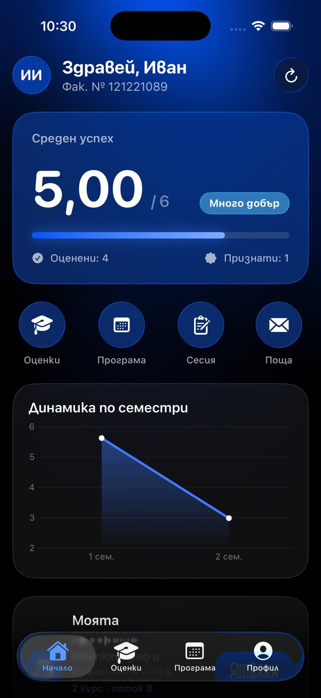
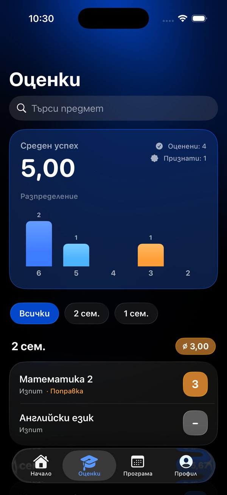
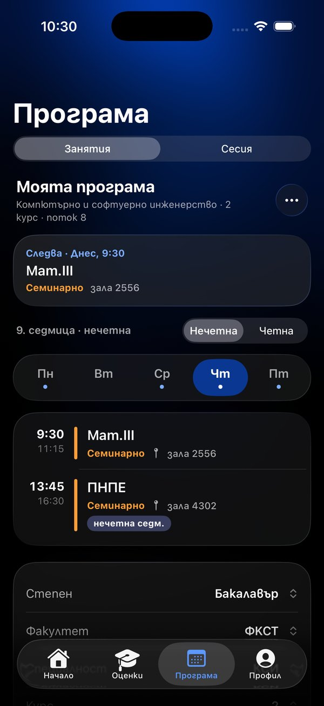
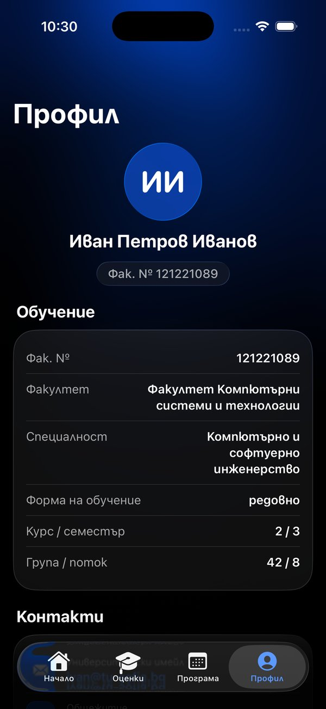

# UniApp 2.0

[](README.md)
[](README.en.md)
[](README.bg.md)

[](https://github.com/fomzzer/UniApp2/releases/latest)

[](https://github.com/fomzzer/UniApp2/actions/workflows/ios.yml)

Неофициален клиент на „Е-Студент“ за студентите на ТУ-София: профил, оценки, общежитие, разписание на занятията и сесията. Изцяло преработена версия 1.0 (Qt/C++): нативен iOS клиент на SwiftUI с Liquid Glass и нов бекенд.

**Изтегляне:** готов `.ipa` за iPhone (iOS 18+) и инструкции за инсталиране има на страницата на [последното издание](https://github.com/fomzzer/UniApp2/releases/latest).

<p align="center">
  
  
  
  
</p>

> Independent, non-commercial student project. Not affiliated with, endorsed by or connected to the Technical University of Sofia. The official university portals remain the authoritative source.

## Структура

```
UniApp2/
├── ios/                 SwiftUI приложение (iOS 18+)
│   ├── project.yml      спецификация за XcodeGen → UniApp.xcodeproj
│   ├── UniApp/          изходен код
│   ├── UniAppTests/     unit тестове
│   └── MailIntegration/ проверка на изпращането на поща срещу истински Roundcube
├── backend/             FastAPI + Docker Compose + Caddy (HTTPS)
├── docs/API.md          договор на API v2 (общ за iOS и бъдещото Android приложение)
└── .github/workflows/   CI: компилиране на .ipa, издания, тестове на бекенда, записи и екранни снимки от симулатора
```

## iOS

- **SwiftUI, iOS 18+**. На iOS 26 — истински Liquid Glass (`glassEffect`, `GlassEffectContainer`, `.glassProminent`), на iOS 18–25 — същият дизайн върху полупрозрачни материали (`DesignSystem/Compat.swift`). Синьо-черна палитра, тъмна тема.
- **Езици**: български и руски, превключват се директно в приложението (по подразбиране — езикът на системата).
- **Вход**: приложението само пита портала какъв е начинът на вход за факултетния номер — ЕГН/ЛНЧ (капчата се решава от сървъра), еднократна парола или парола.
- **Начален екран** в стила на Revolut: средният успех като „баланс“, скала 2–6, бързи действия, графика по семестри, моето разписание, общежитие, последни оценки.
- **Оценки**: семестри, търсене, разпределение на оценките, подробности за предмета с опитите (редовна / поправителна).
- **Разписание**: собственото разписание се показва нативно — „сега“ с напредъка на часа и „следва“, дни от седмицата, четна/нечетна седмица, избор на група и подгрупа, вид на занятието и зала. Ако PDF файлът не може да бъде разчетен, както и за разписанията на други групи и сесията — PDF вътре в приложението с офлайн кеш. Автоматично откриване на „моето“ разписание по профила, закачане, каскадни филтри.
- **Поща**: TUSmail в приложението — папки, непрочетени, прикачени файлове, HTML писма в тъмна гама; ново писмо, отговор, отговор до всички, препращане, флаг, преместване, изтриване в „Кошче“. Четенето е по IMAP, изпращането — през уеб пощата Roundcube на същия сървър (SMTP е затворен отвън).
- **Сигурност**: данните за вход се пазят само в Keychain (`WhenUnlockedThisDeviceOnly`), снимката на данните на диска е с `completeFileProtection`, заключване с Face ID, скриване на съдържанието в превключвателя на приложения.

### Компилиране и CI

Xcode проектът не се пази в хранилището: генерира се от `ios/project.yml` с [XcodeGen](https://github.com/yonaskolb/XcodeGen).

```bash
brew install xcodegen
cd ios && xcodegen generate && open UniApp.xcodeproj
```

Адресът на сървъра се задава с build настройката `UNIAPP_API_HOST` в `ios/project.yml` (само хост, схемата винаги е `https`).

Компилирането не изисква Mac: всичко се изпълнява в GitHub Actions на macOS машини.

- **iOS** — при всяка промяна в `ios/` генерира проекта, пуска unit тестовете на симулатор и компилира неподписан `.ipa`.
- **Release** — компилира версия и я публикува на страницата [Releases](https://github.com/fomzzer/UniApp2/releases) заедно с инструкции за инсталиране.
- **iOS capture** и **iOS screens** — видеозапис на UI тестовете и екранни снимки на всички екрани с тестови данни, с избор на версията на iOS в симулатора.

Версията, номерът на компилацията и краткият хеш на къмита се записват в `Info.plist` и се виждат в приложението в раздел „За приложението“.

## Backend

FastAPI услуга, която не съхранява лични данни:

- `/v2/auth/method`, `/v2/auth/login` — вход в „Е-Студент“ (три начина, умни повторни опити с капчата без риск от блокиране на акаунта, ограничаване на заявките по IP и по факултетен номер), разчитане на профила, оценките и общежитието;
- `/v2/schedules` — разписания на занятията и сесията от официалния JSON API на `tu-sofia.bg`, кеш за 3 часа с обновяване във фонов режим и запис на диска;
- `/v2/timetables/{id}` — PDF разписание, превърнато в списък със занятия: решетка по линиите, обединени клетки, диагонали като четна/нечетна седмица, двучасови колони, няколко дисциплини в една клетка. Разчитат се около 96% от публикуваните PDF файлове; останалите се маркират като `unsupported`. Началото на първата учебна седмица се задава с `UNIAPP_WEEK_ONE` (по подразбиране `2026-09-14`), а в приложението четността може да се смени ръчно;
- `/api/login`, `/api/schedules` — съвместимост със старата версия 1.0.

Подробно: [docs/API.md](docs/API.md).

### Стартиране и тестове

```bash
cd backend
python -m venv .venv && . .venv/bin/activate
pip install -r requirements-dev.txt
UNIAPP_DATA_DIR=./data python -m pytest -q
UNIAPP_DATA_DIR=./data uvicorn app.main:app --reload
```

### Внедряване

Сървърът работи на виртуална машина в Azure с Docker Compose: контейнер `api` с FastAPI зад [Caddy](https://caddyserver.com), който сам получава и подновява сертификат от Let's Encrypt. За това са нужни отворени портове 80 и 443 и домейн, сочещ към IP адреса на машината. Настройките се вземат от `backend/.env` (шаблон — `.env.example`), а `backend/deploy.sh` стартира всичко.

## Android

Договорът на API в `docs/API.md` е общата основа за бъдещ Android клиент (Kotlin + Jetpack Compose). Цялата бизнес логика (разчитане, нормализиране, изчисляване на средния успех, разписания) е на сървъра, така че на клиента остава само интерфейсът.
